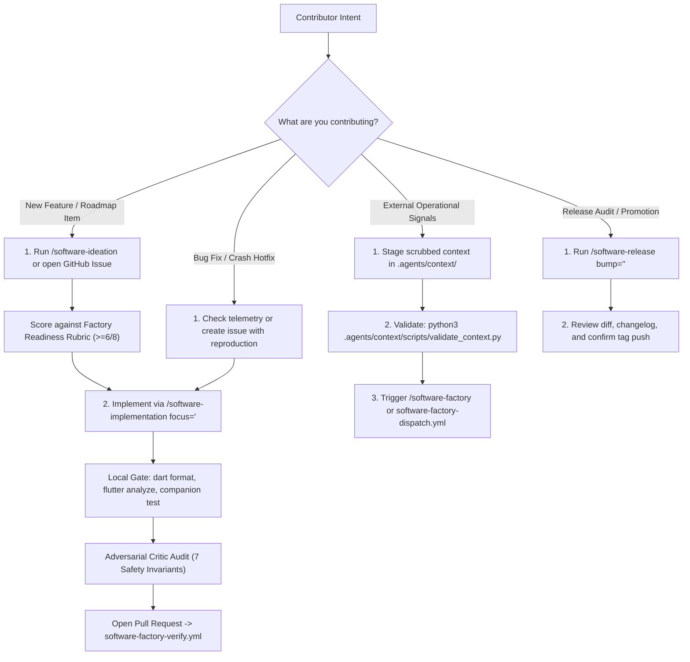

# Contributing to RealizeAlpha

Thank you for your interest in contributing to **RealizeAlpha** (`robinhood-options-mobile`)!

RealizeAlpha is a professional-grade mobile trading, analytics, and risk management platform. We employ a modern **Human–AI Collaborative Engineering** model powered by an **Autonomous AI Software Factory** architecture. Whether you are a human developer, an AI coding agent, or a hybrid team, this guide outlines the repository conventions, safety invariants, and verification workflows required for all contributions.

---

## 1. Core Engineering Principles

1. **Safety First, Always**: Trading and financial software demands zero tolerance for credential leakage, state corruption, or unverified order execution. All contributions must uphold the **7 Core Safety Invariants**.
2. **Deterministic Quality Gates**: Every code change must pass local formatting, static analysis with zero errors, and targeted companion tests before submission.
3. **Continuous Documentation & Roadmap Sync**: Code, tests, and documentation must evolve together. Merged features must be reconciled in [ROADMAP.md](ROADMAP.md), [CHANGELOG.md](CHANGELOG.md), and [PRODUCT.md](PRODUCT.md).

---

## 2. Developing with the Autonomous Software Factory

RealizeAlpha integrates canonical software factory skills under `.github/skills/` to automate specification, test-driven implementation, adversarial review, and roadmap tracking:



| Slash Command / Skill | Scope | Description |
|---|---|---|
| `/software-implementation` | Single Item | Focused Maker–Verifier–Critic loop for an individual feature or bug fix with self-healing gates. |
| `/software-factory` | Multi-Item / Loop | Continuous closed-loop orchestrator chaining ideation, disjoint partitioning, parallel implementation, reconciliation, and release decisions. |
| `/software-ideation` | Discovery | Scans product needs and open issues, scoring proposals against the 8-point Factory Readiness Rubric. |
| `/software-release` | Release Prep | Bumps semantic versions, audits safety invariants, updates release notes, and stages release tags (requiring explicit human confirmation before push). |
| `/update-docs` | Doc Hygiene | Reconciles roadmap progress, bounds Key Highlights ($\le 5$), and synchronizes `CHANGELOG.md`. |

For the complete architectural specification, state machine flowchart, and operational runbook, consult the [Autonomous Software Factory Architecture Guide](docs/software-factory.md).

---

## 3. The 7 Core Safety Invariants

Every pull request is reviewed—both by automated CI gates and an independent Adversarial Critic agent—against these mandatory invariants from [AGENTS.md](AGENTS.md):

1. **Zero Plaintext Credentials (`SecureTokenStorage`)**:
   - Brokerage OAuth tokens, refresh tokens, and MCP credentials must be stored exclusively via `SecureTokenStorage` backed by Keychain/Keystore.
   - Never write plaintext tokens or API keys to `SharedPreferences`, Firestore documents, or source code.
2. **Feature Access Precedence (`FeatureAccessService`)**:
   - Capabilities must follow the 4-tier hierarchy: Remote Config Kill Switch $\to$ User Flag Override $\to$ Admin-Only $\to$ Beta Labs Opt-In $\to$ Public GA.
3. **Trading & Order Execution Safeguards**:
   - Live-quote BUY guard: Must re-verify live quote before BUY execution; deviations $> 3\%$ block execution.
   - Paper trading isolation: Paper orders and TP/SL exits remain strictly simulated over the paper ledger without mutating live margin.
4. **Balance Visibility & Privacy (`AccountStore`)**:
   - Respect global balance masking (`$••••••`) across hero metrics, position rows, tooltips, and charts.
5. **Backend Security & Algorithmic Efficiency**:
   - Cloud Functions must verify `request.auth` and validate client inputs.
   - Technical indicator loops and backtesting routines must maintain $O(1)$ auxiliary memory space without per-bar array allocations.
6. **UI Polish & Accessibility**:
   - Financial rows, options badges, and complex cards must provide natural `Semantics(label: ...)` spoken screen-reader descriptions.
   - Layouts must be responsive down to `320px` viewports without `RenderFlex` overflows.
7. **Zero Compile Errors & Strict Types**:
   - Code must pass `flutter analyze --no-fatal-infos` and TypeScript `npm run build` with zero compile or typing errors.

---

## 4. Local Development & Verification Gates

Before submitting a pull request, run the local verification gates matching our CI pipeline:

### Flutter / Mobile Client (`src/robinhood_options_mobile/`)
```bash
cd src/robinhood_options_mobile

# 1. Format code (strict check)
dart format --output=none --set-exit-if-changed .

# 2. Static analysis (zero errors / warnings)
flutter analyze --no-fatal-infos

# 3. Run impacted companion tests (e.g. for a modified service)
flutter test test/<impacted_test_file>.dart
```

### Cloud Functions Backend (`src/robinhood_options_mobile/functions/`)
```bash
cd src/robinhood_options_mobile/functions

# 1. Lint (Google ESLint max-len <= 80)
npm run lint

# 2. TypeScript compilation
npm run build

# 3. Unit tests
npm test
```

### Fast CI Dry-Run via Software Factory
You can simulate the complete software factory verification gate locally:
```bash
python3 .github/skills/software-factory/scripts/factory_pipeline.py --mode=autonomous --stages=ideate --dry-run
```

---

## 5. Pull Request & Commit Guidelines

1. **Branch Naming**:
   - `feature/<feature-name>` for new capabilities
   - `fix/<bug-description>` for bug fixes
   - `refactor/<scope>` for code cleanup
2. **Conventional Commits**:
   - `feat(trading): add option volatility skew alert (#354)`
   - `fix(portfolio): prevent balance mask flicker during stream refresh (#355)`
   - `docs(factory): document release cadence and feature grouping`
3. **Issue Linking**:
   - Always reference the tracking GitHub issue in the commit message and PR description.
4. **Automated CI Gates**:
   - Every PR triggers `software-factory-verify.yml` which validates safety invariants, workflow YAML syntax, Python AST compilation, and strict static analysis.
   - Merges to `main` require all checks to pass cleanly.

---

## 6. Supplying External Context to the Software Factory

Human engineers and product leads can steer autonomous factory cycles by providing structured external context in [`.agents/context/`](.agents/context/README.md):

- **Crash Telemetry (`telemetry_crashes.json`)**: Drop top-frequency Crashlytics/Sentry clusters into `.agents/context/telemetry_crashes.json` using [`telemetry_crashes.template.json`](.agents/context/telemetry_crashes.template.json). The factory will automatically prioritize them as accelerated hotfixes.
- **User Feedback (`user_feedback.json`)**: Provide review digests or survey summaries using [`user_feedback.template.json`](.agents/context/user_feedback.template.json) to guide UI polish and customer friction remediation.
- **Team Discussion Briefs (`developer_brief.json`)**: Summarize architectural decisions or priority tasks from Slack, Teams, WhatsApp, or Discord using [`developer_brief.template.json`](.agents/context/developer_brief.template.json).
- **Zero PII Rule**: Always ensure customer PII, private tokens, and account numbers are scrubbed before staging context. Validate your staged context files locally before launching the factory:
  ```bash
  python3 .agents/context/scripts/validate_context.py --check-staged
  ```

---

## 7. Feedback & Community

- **Found a bug?** Open an issue on [GitHub Issues](https://github.com/CIInc/robinhood-options-mobile/issues).
- **Proposing an enhancement?** Review [PRODUCT.md](PRODUCT.md) and [ROADMAP.md](ROADMAP.md) before opening a feature request.
- **Questions on Agent Tooling?** Review [AGENTS.md](AGENTS.md) and [docs/software-factory.md](docs/software-factory.md).
