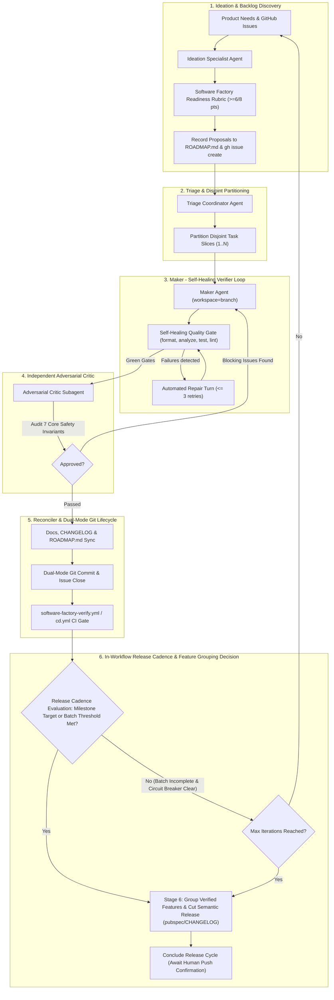
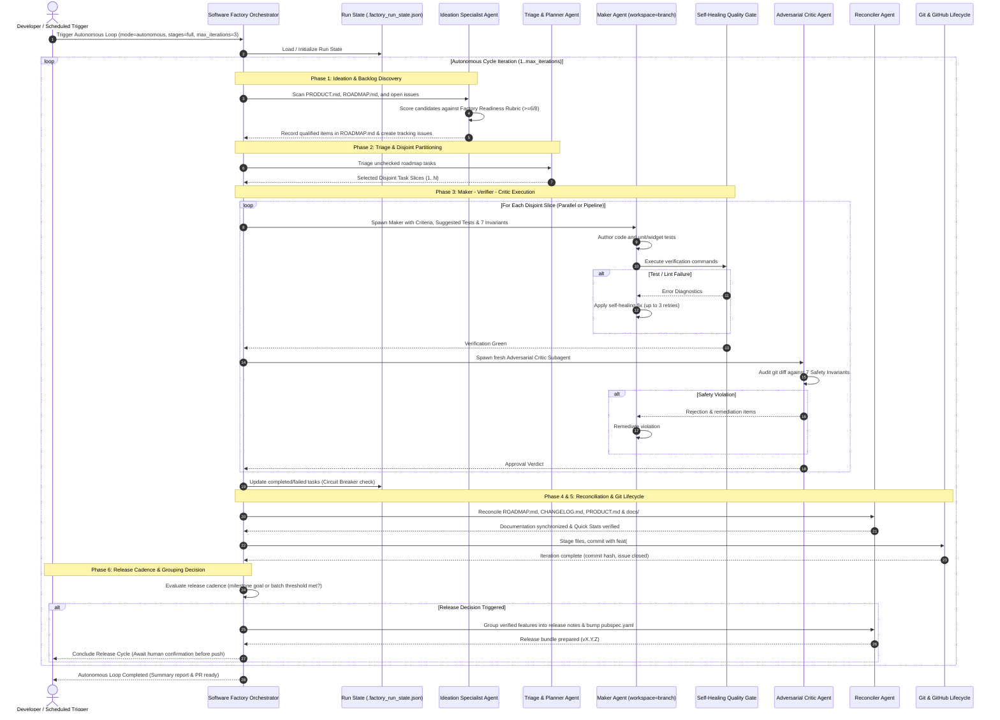
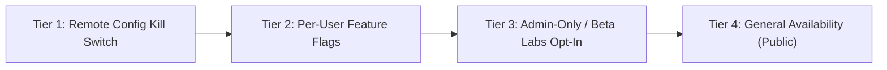
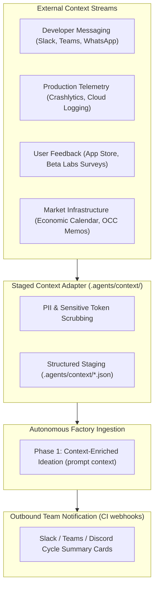

# Autonomous AI Software Factory Architecture, Patterns & Tooling

RealizeAlpha incorporates an **Autonomous AI Software Factory** architecture designed to automate, streamline, and safely scale software engineering, verification, release management, and documentation synchronization across the Flutter, Firebase, and Cloud Functions codebases.

---

## 1. Architectural Overview & Closed-Loop Pattern

The RealizeAlpha Software Factory transitions engineering workflows from manual, single-prompt instructions into a continuous, self-driving **Autonomous Loop** that chains feature discovery, specification, implementation, adversarial verification, and documentation reconciliation:



---

## 1.1 Quick-Reference CLI Cheat Sheet

Use these copy-pasteable slash command invocations or the `./scripts/factory.sh` developer CLI for common engineering workflows:

| Developer Scenario | Slash Command Invocation | Developer CLI (`scripts/factory.sh`) | Description |
|---|---|---|---|
| **Autonomous Loop Overnight** | `/software-factory mode="autonomous" stages="full" max_iterations=3` | `./scripts/factory.sh run "<focus>" 3` | Runs continuous closed loop: ideate, score, triage, parallel implement, verify, reconcile, and commit. |
| **Autonomous Milestone Release** | `/software-factory release_cadence="milestone" release_threshold=3` | `./scripts/factory.sh run "" 3` | Evaluates in-workflow feature grouping and cuts a semantic release when batch threshold is reached. |
| **Simulation / Dry-Run** | `/software-factory dry_run=true stages="full"` | `./scripts/factory.sh dry-run "<focus>"` | Simulates a cycle without writing files, state, metrics, or commits (full output requires `run_workflow`). |
| **Single-Item Interactive** | `/software-implementation mode="interactive" focus="<title>"` | `./scripts/factory.sh interactive "<title>"` | Guided Maker-Verifier-Critic loop with human approval checkpoints before staging commits. |
| **Ideation & Backlog Discovery** | `/software-ideation focus="agentic trading"` | `./scripts/factory.sh dry-run "agentic trading"` | Evaluates backlog candidates against the 8-point Readiness Rubric and records qualified proposals. |
| **Context Schema Validation** | — | `./scripts/factory.sh context check` | Validates templates and live context for schemas and Zero-PII compliance. |
| **Mock Context Generation** | — | `./scripts/factory.sh context sample telemetry` | Scaffolds mock telemetry or user feedback fixtures for offline testing. |
| **Telemetry Dashboard** | — | `./scripts/factory.sh metrics [--ascii]` | Displays execution performance dashboard, pass rates, and cycle latency. |
| **Release Preparation & Audit** | `/software-release bump="patch"` | — | Prepares semantic version bump, syncs release notes, audits safety invariants, requiring manual push confirmation. |
| **Documentation Synchronization** | `/update-docs` | — | Reconciles `ROADMAP.md` Quick Stats, bounds Key Highlights ($\le 5$), and updates `CHANGELOG.md`. |
| **Disaster Recovery (Resume)** | `/software-factory mode="autonomous"` | `./scripts/factory.sh run` | Automatically reads `.agents/.factory_run_state.json` and resumes from the last completed iteration. |
| **Reset Circuit Breaker** | — | `./scripts/factory.sh reset` | Clears tripped failure counters and unblocks autonomous factory execution. |

> [!NOTE]
> Outside `run_workflow`, `factory.sh` runs the pipeline with **stubbed agents**: it exercises control flow, context loading, and test mapping, but produces no ideation, rubric scores, or execution DAG. Dry-runs write no files, state, or metrics.

Parallel multi-item execution via `run_workflow` (real agents):

```python
call_tool("run_workflow",
  ScriptPath=".github/skills/software-factory/scripts/factory_pipeline.py",
  Description="Execute autonomous software factory loop for v0.62.x",
  Args={
    "mode": "autonomous",
    "stages": "full",
    "dry_run": False,
    "max_parallel": 2,
    "max_iterations": 3,
    "failure_limit": 2,
    "focus": "v0.62.x"
  }
)
```

---

## 1.2 What Is Implemented in Code vs. Agent-Guided

| Capability | Enforcement |
|---|---|
| Companion test mapping, context schema/PII validation, metrics ledger & dashboard, run-state resume, circuit breaker counter, changelog prefix categorization | **Deterministic code** (`factory_pipeline.py`, `validate_context.py`, `metrics_summary.py`), unit-tested |
| Format/analyze/test/lint gates, ROADMAP bounds, plaintext-token scan, no committed live context | **CI** (`software-factory-verify.yml`) |
| Ideation, rubric scoring, deduplication judgment, triage/partitioning, critic verdicts, release grouping & version bump | **Agent-guided** (prompts + structured output schemas under `run_workflow`) |
| Model fallback on quota exhaustion, release blackout around macro events | **Manual / planned** — not automated today |

---

## 2. The Autonomous Loop Engine & Execution Topology

In `mode=autonomous`, the factory operates as a continuous closed loop, driving work forward until the target horizon is completed or maximum iterations are reached.



### 2.1 Full-Cycle Phases
When invoked with `stages="full"`, each loop iteration runs six phases (Phase 3 runs the per-task 5-stage state machine in §4):
1. **Ideation & Backlog Discovery**: Scans `PRODUCT.md`, `ROADMAP.md`, and open GitHub issues. Scores candidate proposals against the **Software Factory Readiness Rubric** (bounded scope, testable without external live credentials, compliant with the 7 safety invariants) and automatically records qualified items in `ROADMAP.md` under their appropriate milestone horizon.
2. **Triage & Disjoint Partitioning**: Evaluates unchecked tasks in the active horizon and selects up to `max_parallel` items with mutually disjoint file boundaries.
3. **Implementation & Verification**: Executes the Maker agent and Self-Healing Verifier loop with companion test mapping and up to 3 repair retries.
4. **Adversarial Critique**: Spawns an isolated critic subagent that audits the diff against the 7 Core Safety Invariants without shared author bias, producing a structured `CriticAuditVerdict`.
5. **Reconciliation & Git Lifecycle**: Reconciles documentation, updates `ROADMAP.md` Quick Stats, creates conventional commits (`feat(...): ... (#<num>)`), and closes verified issues (`gh issue close <num>`).
6. **Release Cadence & Grouping Decision**: Evaluates milestone/batch completion criteria. If satisfied, groups completed features, bumps semantic version in `pubspec.yaml`, generates release notes in `CHANGELOG.md`, and concludes the cycle.

### 2.2 Disjoint Ownership Partitioning Rule
When running multiple tasks in parallel (`max_parallel > 1` via `workspace="branch"` or `workspace="share"`):
- Workers may only touch **mutually disjoint source files** in `src/robinhood_options_mobile/lib/` and `src/robinhood_options_mobile/functions/src/`. For example, Task A modifying `portfolio_analytics_controller.dart` cannot run concurrently with Task B modifying the same controller.
- Shared top-level files (`ROADMAP.md`, `CHANGELOG.md`, `PRODUCT.md`, `pubspec.yaml`) are **never edited by concurrent workers**. Instead, the coordinator reconciles shared files once in the final aggregation phase to eliminate git merge conflicts.

---

### 2.3 Release Cadence
Release cuts are decided inside the loop (Phase 6) rather than after the backlog empties, because ideation keeps adding work. `release_cadence` is `milestone` (default; cut when the active milestone is done or `release_threshold` features are verified), `batch_size` (cut every `release_threshold` features), or `manual`. Future-milestone proposals are tagged `future_horizon` so they do not extend the current release. Pushing release tags to `main` always requires human confirmation. Rationale: [ADR-003](adr/0003-in-workflow-release-cadence.md).

---

## 3. Software Factory Readiness Rubric Matrix

Candidate items discovered during ideation or pulled from GitHub issues must be evaluated against this 4-dimension scoring rubric before autonomous implementation:

| Rubric Dimension | 0 Points (Disqualified) | 1 Point (Marginal) | 2 Points (Factory-Ready) |
|---|---|---|---|
| **Scope & Boundaries** | Crosses multiple platform layers or repositories | Touches $>5$ major state stores or screens | Isolated to $1-3$ related files with clear interfaces |
| **Hermetic Testability** | Requires live brokerage OAuth credentials or real money | Requires complex external server emulation | Fully testable with `fake_cloud_firestore`, `package:test`, and mocks |
| **Safety Invariants** | Violates or bypasses core risk controls | Requires elevated human admin override | Strictly complies with all 7 safety invariants |
| **Code Ownership** | Unclear architecture or brand-new tech stack | Extends legacy unmaintained components | Clear existing `ChangeNotifier` store, widget, or service owner |

> [!IMPORTANT]
> **Promotion Threshold**: An item must achieve a total score $\ge 6/8$ points with **0 points in zero categories** to be automatically added to `ROADMAP.md` and scheduled for execution in autonomous mode.

---

## 4. Per-Task 5-Stage State Machine (Phase 3)

### Stage 1: Specification, Ideation & Triage
- **Source of Truth**: `ROADMAP.md` and open GitHub issues (`gh issue list --state open --limit 1000 --json number,title,body,labels,milestone,updatedAt`).
- **Ideation Discovery**: Identifies unaddressed gaps, validates proposals against the Software Factory Readiness Rubric, and creates structured tracking issues.
- **Triage**: Actionable unchecked items (`- [ ]`) are filtered by milestone, priority, and clear code ownership.
- **Safety Invariant Extraction**: Extracts the applicable RealizeAlpha core safety invariants from `AGENTS.md` before writing code.

### Stage 2: Maker (Code & Tests)
- Implements the minimal, complete change satisfying the criteria.
- Adheres to repository architectural patterns:
  - Mobile app: `src/robinhood_options_mobile/lib/`
  - Cloud Functions: `src/robinhood_options_mobile/functions/src/`
  - Firestore security rules: `src/robinhood_options_mobile/firebase/firestore.rules`
- Authors focused unit and widget tests covering standard flows, edge cases, and regression boundaries using impact-based companion test mapping.

### Stage 3: Self-Healing Verification Gate
The agent automatically executes targeted verification with an automated repair loop (up to 3 bounded retries):
1. **Dart Code Formatting**:
   ```bash
   cd src/robinhood_options_mobile && dart format --output=none --set-exit-if-changed .
   ```
2. **Strict Dart Static Analysis**:
   ```bash
   cd src/robinhood_options_mobile && dart analyze
   ```
3. **Targeted Flutter Tests**:
   ```bash
   cd src/robinhood_options_mobile && flutter test test/<impacted_test_file>.dart
   ```
4. **Cloud Functions Lint, Build & Tests**:
   ```bash
   cd src/robinhood_options_mobile/functions && npm run lint && npm run build && npm test
   ```
If any check fails, the agent inspects the stack trace, diagnoses root causes, applies a targeted patch, and re-tests.

### Stage 4: Independent Adversarial Critic (7 Core Safety Invariants)
Before concluding any implementation task, the changes are audited against RealizeAlpha's 7 Core Safety Invariants (either via a dedicated critic subagent or an explicit adversarial audit table):

| # | Invariant | Verification Standard |
|---|---|---|
| **1** | **Zero Plaintext Credentials** | Brokerage OAuth tokens and API secrets must be stored exclusively via `SecureTokenStorage` (`flutter_secure_storage`). Never write secrets to `SharedPreferences` or Firestore. |
| **2** | **Feature Access Hierarchy** | Precedence follows Remote Config `disabled` kill switch $\to$ explicit per-user overrides $\to$ `adminOnly` / `beta` / `public` stage in `FeatureAccessService`. |
| **3** | **Trading Safeguards & Quote Isolation** | Live-quote BUY guard ($> 3\%$ deviation block), Paper TP/SL exits isolated through simulated ledger (`account == null`), and dynamic sizing boundaries respected. |
| **4** | **Balance Masking & Privacy** | Masked portfolio balances (`AccountStore`) respected across all charts, widgets, and tooltips; multi-broker tax lots stay on-device. |
| **5** | **Cloud Functions Security & $O(1)$ Space** | All callables authenticate `request.auth` and validate inputs; technical indicator and backtest loops maintain $O(1)$ auxiliary space without slicing arrays per bar. |
| **6** | **UI Polish & Accessibility** | Financial rows consolidate spoken screen-reader text via `Semantics(label: ...)`; layouts do not overflow down to `320px` viewports. |
| **7** | **Zero Compile Errors & Strict Types** | Verification with `dart analyze` and `npm run build` shows zero warnings treated as errors or type mismatches. |

### Stage 5: Reconciler & Dual-Mode Git Lifecycle
- Synchronizes documentation across `docs/`, `PRODUCT.md`, `CHANGELOG.md`, and `ROADMAP.md`.
- Maintains `ROADMAP.md` invariants: bounded `Key Highlights` ($\le 5$ items), bounded `Completed Features ✅` focused on recent minor releases, and verified `Quick Stats`.
- **Dual-Mode Execution**:
  - **Interactive Mode**: Presents all diffs, tests, and documentation updates to the developer. Does not commit, push, or close GitHub issues unless requested.
  - **Autonomous / Factory Mode (`mode=autonomous`)**: Creates conventional commits (`feat(<scope>): <summary> (#<issue-num>)`), adds test evidence to the GitHub issue, and closes the issue with `gh issue close <num>`. Continues to the next iteration of the loop until `max_iterations`, backlog exhaustion, or circuit breaker trip.

---

## 5. Agent Roles & Model Topology

To balance reasoning capability, latency, and token efficiency, the Software Factory assigns specific models to distinct subagent roles:

| Agent Role | Model Recommendation | Tooling Mode | Primary Focus |
|---|---|---|---|
| **Ideation Specialist** | Pro / High-Reasoning | Read-only + GitHub CLI | Backlog discovery, product principle alignment, rubric scoring |
| **Triage Coordinator** | Flash / Balanced | Read-only | Disjoint file partitioning, dependency resolution, acceptance spec |
| **Maker Agent** | Pro / High-Reasoning | Read-Write (`workspace="branch"`) | Minimal complete implementation, unit/widget test authoring |
| **Adversarial Critic** | Pro (Isolated Context) | Read-only | Diff inspection, 7-invariant checklist enforcement, edge-case probing |
| **Docs Reconciler** | Flash / Balanced | Read-Write | Documentation sync, `ROADMAP.md` formatting, Quick Stats arithmetic |
| **Lifecycle Manager** | Flash_Lite / Fast | Read-Write | Conventional commits, GitHub issue closing comments |

### Machine-Readable Critic Audit Verdict Schema (`CriticAuditVerdict`)

To ensure deterministic gating without natural language ambiguity, the Adversarial Critic produces a structured JSON verdict:

```json
{
  "approved": true,
  "invariants": {
    "zero_plaintext_credentials": true,
    "feature_access_precedence": true,
    "trading_safeguards": true,
    "balance_visibility_privacy": true,
    "backend_security_complexity": true,
    "accessibility_ui_polish": true,
    "zero_compile_errors_integrity": true
  },
  "blocking_issues": [],
  "audit_notes": "All 7 core trading safety invariants confirmed clean. Live-quote BUY guard verified."
}
```

### Quota Limits (Manual Procedure)
There is no automatic model fallback. If a `pro` agent hits quota mid-run, the iteration fails and run state in `.agents/.factory_run_state.json` is preserved. Either wait for quota to reset and re-run `./scripts/factory.sh run`, or re-launch with lighter models for the affected roles.

### Token Cost & Throughput Optimization
- **Tiering Strategy**: Keep high-volume iterative repair loops (format, analyze, fix) on fast, cost-effective models (`flash`), reserving reasoning-dense models (`pro`) for initial architecture specification and independent adversarial safety auditing.
- **Prompt Token Isolation**: Maker subagents execute inside isolated branch workspaces (`workspace="branch"`) with clean context windows, preventing bloated turn histories from degrading analysis speed.

---

## 6. Feature Flag & Progressive Rollout Lifecycle (`FeatureAccessService`)

Every new user-facing capability implemented by the Software Factory must integrate into RealizeAlpha's **4-tier progressive rollout architecture** ([`docs/feature-access-and-beta-gating.md`](feature-access-and-beta-gating.md)):



### 1. Progressive Rollout Stages
1. **Stage 1 (Admin Only)**:
   - When a new capability is authored by the Maker agent, it is added to `FeatureBundle` with default stage `adminOnly`.
   - Only admin accounts with explicit opt-in can access the feature, protecting standard users during initial deployment.
2. **Stage 2 (Beta Labs Self-Serve Opt-In)**:
   - Once verified, the feature is promoted to `stage: FeatureStage.beta`.
   - Surfaced inside `BetaLabsWidget` under User Settings, allowing early-adopter traders to voluntarily opt in, test, and provide feedback.
3. **Stage 3 (General Availability)**:
   - Following stable telemetry and zero safety incidents across a release cycle, the feature is promoted to `stage: FeatureStage.public`.
   - Turned on by default for all users, with instant remote kill-switch protection via Firebase Remote Config.

### 2. Maker Agent Implementation Checklist
When authoring a new feature, the Maker agent must:
- Declare the feature bundle in `src/robinhood_options_mobile/lib/model/feature_access.dart` (or corresponding model).
- Wrap UI entry points with `FeatureAccessService.instance.isFeatureEnabled(FeatureBundle.<feature>, userRole: userRole)`.
- Author a dedicated unit test in `test/feature_access_service_test.dart` asserting that unauthenticated or non-beta users cannot access the gated screens.
- Confirm Invariant 2 compliance in the `CriticAuditVerdict` output.

---

## 7. Operational Runbook & Troubleshooting

### Handling Self-Healing Gate Exhaustion (3 Failed Retries)
When a task fails verification 3 times consecutively:
1. The Maker agent halts and logs the diagnostic failure stack trace.
2. The orchestrator records the task ID in `.agents/.factory_run_state.json` under `failed_tasks`.
3. If parallel workers are active, other disjoint tasks continue unaffected.
4. The task is preserved in `ROADMAP.md` as unchecked (`- [ ]`) and the GitHub issue remains open with failure details.

### Cleaning Up Temporary Parallel Workspaces
Parallel agents run in isolated clones (`workspace="branch"`). Antigravity automatically manages these workspaces. To manually inspect or clean up stale worktrees:
```bash
git worktree list
git worktree prune
```

### Troubleshooting Matrix

When autonomous cycles encounter environment anomalies or gate rejections, consult this diagnostic reference matrix:

| Failure Mode / Symptom | Diagnostic Cause | Immediate Resolution Command | Prevention / Best Practice |
|---|---|---|---|
| **Circuit Breaker Tripped**<br>`CircuitBreaker: True`<br>`consecutive_failures >= 2` | Critic rejected changes across 2 consecutive iterations due to safety invariant violations or gate timeouts. | `./scripts/factory.sh reset`<br>`/software-factory mode="autonomous"` | Inspect `.factory_run_state.json` for specific failed tasks; address underlying invariant breach before resuming. |
| **Git Index Lock Collision**<br>`Unable to create '.git/index.lock'` | A parallel git operation or previous process terminated uncleanly while holding the index lock. | Confirm no git process is running, then `./scripts/factory.sh reset --force-unlock` | Avoid concurrent manual git commands while an autonomous loop is actively executing. |
| **Companion Test Not Found**<br>`Warning: No companion test found` | Source file in a nested directory (`lib/services/`, `lib/widgets/`) lacks a mirrored or flat test file. | Dual-path resolution automatically checks `test/<name>_test.dart` and `test/<dir>/<name>_test.dart`. Maker agent creates `test/<name>_test.dart`. | Follow standard naming conventions: `lib/<path>/<name>.dart` $\to$ `test/<name>_test.dart`. |
| **Disjoint Partitioning Collision**<br>`Tasks touch non-disjoint files` | Multiple unreleased tasks modify overlapping state stores (e.g. `PortfolioStore`) or shared widgets. | The Triage agent is instructed to defer colliding tasks to later iterations; verify in the triage output. | Keep feature scope focused on 1–3 files to maximize parallel partition capacity. |
| **Staged Context PII Leak**<br>`validate_context.py failed` | External context contains unscrubbed emails, Bearer tokens, API keys, or customer account identifiers. | `python3 .agents/context/scripts/validate_context.py --check-staged`<br>Sanitize violating tokens in `.agents/context/*.json`. | Always scrub identifiers and verify `pii_scrubbed: true` before staging runtime telemetry. |
| **Infinite Backlog Loop**<br>`Iterations exhausted on ongoing ideation` | Continuous loop discovers new ideas endlessly without cutting a release. | Specify `release_cadence="milestone"` or `release_threshold=2` to group verified features into a release cut. | Ensure in-workflow release cadence decisions evaluate milestone completion boundaries. |

---

## 8. External Context Ingestion & Team Feedback Loops

To prevent operating in an insular vacuum, the Software Factory connects directly to real-world operational context through a **Staged Context Adapter Pattern** ([`.agents/context/`](../.agents/context/README.md)):



### 1. Ingested External Streams
1. **Developer & Team Messaging Digests (`developer_brief.json`)**:
   - Integrates conversation digests from Slack, Microsoft Teams, WhatsApp, and Discord.
   - Converts high-priority architectural discussions and temporary workarounds into structured candidate proposals.
2. **Production Crash Telemetry (`telemetry_crashes.json`)**:
   - Ingests high-velocity crash and exception clusters from Firebase Crashlytics and GCP Cloud Logging.
   - Passed to the Ideation agent, which is instructed to propose high-severity crash clusters as hotfix candidates (with stack trace and file) ahead of feature work.
3. **End-User Feedback & Beta Labs Voice (`user_feedback.json`)**:
   - Ingests App Store reviews, Google Play user comments, and Beta Labs surveys.
   - Pre-clustered friction points are passed to the Ideation agent to inform UI polish and accessibility proposals.
4. **Market Calendar & Economic Infrastructure (`market_calendar.json`)**:
   - Staged macro dates (FOMC rate decisions, CPI releases, quadruple witching, exchange holidays) and OCC corporate action memos.
   - Passed to the Ideation and Release agents as context. **Not enforced:** nothing currently blocks releases around these events; check the calendar manually before promoting trading-engine changes.

### 2. Privacy & PII Scrubbing Rules
- External context collectors must scrub customer identifiers, private account balances, passwords, and brokerage OAuth credentials before writing to `.agents/context/`.
- Live context files (`.agents/context/*.json`) are ignored by `.gitignore`, ensuring transient runtime telemetry is never committed to repository history.

### 3. Outbound Team Webhooks
Upon cycle completion or release cut in GitHub Actions (`software-factory-dispatch.yml`), the factory posts a summary message to the team's messaging channel via `SLACK_WEBHOOK_URL`, `TEAMS_WEBHOOK_URL`, or `DISCORD_WEBHOOK_URL`.

---

## 9. Tooling & Skills Directory

RealizeAlpha organizes its software factory capabilities into modular skills located in `.github/skills/`:

### 1. `software-factory`
- **Location**: [`.github/skills/software-factory/SKILL.md`](../.github/skills/software-factory/SKILL.md)
- **Workflow Script**: [`.github/skills/software-factory/scripts/factory_pipeline.py`](../.github/skills/software-factory/scripts/factory_pipeline.py)
- **Role**: Top-level autonomous closed-loop factory orchestrator. Runs the closed loop: Ideate $\to$ Triage $\to$ Parallel Maker/Critic Implementation $\to$ Docs Sync $\to$ Git Lifecycle across multiple iterations.

### 2. `software-implementation`
- **Location**: [`.github/skills/software-implementation/SKILL.md`](../.github/skills/software-implementation/SKILL.md)
- **Role**: Single-item focused implementation engine. Executes the 5-stage Maker-Verifier-Critic loop, self-healing quality gates, invariant audits, and Dual-Mode git lifecycle.

### 3. `software-ideation`
- **Location**: [`.github/skills/software-ideation/SKILL.md`](../.github/skills/software-ideation/SKILL.md)
- **Role**: Discovers, shapes, and ranks candidate roadmap proposals by cross-referencing `ROADMAP.md` and GitHub issues. Evaluates proposals against the **Software Factory Readiness Rubric** (bounded scope, testable without external live credentials, adheres to 7 safety invariants).

### 4. `update-docs`
- **Location**: [`.github/skills/update-docs/SKILL.md`](../.github/skills/update-docs/SKILL.md)
- **Role**: Automated documentation synchronization and roadmap invariant checking. Verifies `Quick Stats`, caps `Key Highlights` at $3-5$ items, and ensures `pubspec.yaml` semantic version consistency.

### 5. `software-release`
- **Location**: [`.github/skills/software-release/SKILL.md`](../.github/skills/software-release/SKILL.md)
- **Role**: Prepares semantic releases (`pubspec.yaml`, `CHANGELOG.md`, `ROADMAP.md`), verifies all claimed `[x]` items have tests, runs quality gates, and handles release tagging while strictly preserving human confirmation before pushing release commits to `main`.

---

## 10. CI/CD Integration & Automated Gates

The Software Factory integrates directly into GitHub Actions workflows:

1. **`software-factory-verify.yml`**:
   - Fast PR and branch verification workflow with concurrency cancellation and path-filtered execution (`dorny/paths-filter@v3`).
   - Runs static safety invariant checks (e.g. scanning for plaintext tokens written to `SharedPreferences`), validates workflow YAML files, verifies Python script syntax, and checks `ROADMAP.md` structural invariants.
   - Executes strict `dart format`, `flutter analyze --no-fatal-infos`, impacted tests, and Cloud Functions `npm run lint && npm run build && npm test`.

2. **`software-factory-dispatch.yml`**:
   - On-demand and scheduled `workflow_dispatch` trigger supporting parameters: `mode`, `stages`, `dry_run`, `max_iterations`, `failure_limit`, and `focus`.
   - Executes verification gates, outputs GITHUB_STEP_SUMMARY tables, and archives `.agents/.factory_*.json` run state and metrics as job artifacts.

3. **`cd.yml`**:
   - Enforces strict static analysis (with `continue-on-error: true` removed from `flutter analyze`) and Cloud Functions TypeScript compilation on all pushes to `main` and release builds.
   - Automatically extracts categorized release notes from `CHANGELOG.md` for Google Play (`distribution/whatsnew/whatsnew-en-US`) and TestFlight (`WhatToTest.en-US.txt`).

---

## 11. Step-by-Step Execution Walkthrough Case Study

The following concrete case study illustrates how a candidate feature (*"Option Volatility Skew Real-Time Alert"*) progresses through Phases 1–5 (no release cut in this example):

### Phase 1: Ideation & Rubric Scoring
- **Discovery**: The Ideation agent scans `PRODUCT.md` and discovers that while higher-order Greeks (Charm, Vanna) exist, traders lack automated push notifications when 30-day IV skew diverges past historical percentiles.
- **Rubric Evaluation**:
  - *Scope & Boundaries*: Touches `PortfolioAlertService` and `OptionPositionStore` (2 files) $\to$ **2 pts**.
  - *Testability*: Deterministic math tested with fake quotes in `test/portfolio_alert_service_test.dart` $\to$ **2 pts**.
  - *Safety Invariants*: No token storage, respects balance masking, $O(1)$ scalar calculation $\to$ **2 pts**.
  - *Code Ownership*: Clear ownership under `lib/services/portfolio_alert_service.dart` $\to$ **1 pt**.
  - **Total Score**: **7/8 (Qualified $\ge 6$)**.
- **Backlog Recording**: The agent appends the item to `ROADMAP.md` under `v0.62.x` and creates GitHub issue `#354`.

### Phase 2: Triage & Disjoint Partitioning
- **Coordinator Assignment**: Triage selects `#354` and maps disjoint files:
  - Source: `src/robinhood_options_mobile/lib/services/portfolio_alert_service.dart`
  - Inferred Companion Test: `src/robinhood_options_mobile/test/portfolio_alert_service_test.dart`
- **Isolation**: Work is partitioned to an isolated branch workspace (`workspace="branch"`).

### Phase 3: Maker – Verifier – Critic Execution
- **Maker Agent**: Implements skew threshold calculations in `portfolio_alert_service.dart` and authors 3 unit tests in `portfolio_alert_service_test.dart`.
- **Self-Healing Verification Gate**:
  - *Attempt 1*: `dart format --set-exit-if-changed` fails due to trailing comma placement on line 84.
  - *Repair Turn*: The Maker agent parses the diagnostic output, formats the block, and re-executes.
  - *Attempt 2*: `dart format`, `dart analyze`, and `flutter test test/portfolio_alert_service_test.dart` all return exit code 0 (**Green Gate**).
- **Adversarial Critic Subagent**: An independent fresh-context agent reviews `git diff`, confirms zero credential leakage, validates alert throttling, and outputs `approved: true` with all 7 invariant checks marked `true`.

### Phase 4: Reconciliation
- The Reconciler agent updates `ROADMAP.md` marking the checklist item complete (`- [x] ... (#354)`), increments `Quick Stats` completed count, appends an entry to `CHANGELOG.md` under `### Added`, and updates `docs/custom-alerts.md`.

### Phase 5: Git Lifecycle
- In autonomous mode, the Lifecycle agent commits the changes (`feat(alerts): add option volatility skew real-time notifications (#354)`), posts the verification summary and test logs as a comment on GitHub issue `#354`, and closes the issue (`gh issue close 354`).
- Cycle metrics are saved to `.agents/.factory_metrics.json`, and the loop iterates to the next backlog item.

---

## 12. Architecture Decision Records

Design decisions are recorded as ADRs in [`docs/adr/`](adr/README.md):

| ADR | Decision |
|---|---|
| [ADR-001](adr/0001-stage-boundary-gates.md) | Retire per-tool hooks in favor of stage-boundary quality gates and canonical `software-*` skills. |
| [ADR-002](adr/0002-staged-external-context.md) | Feed external signals through a scrubbed, gitignored filesystem buffer (`.agents/context/`) instead of live API access. |
| [ADR-003](adr/0003-in-workflow-release-cadence.md) | Decide release cuts inside the loop (cadence + horizon isolation) instead of waiting for an empty backlog. |
