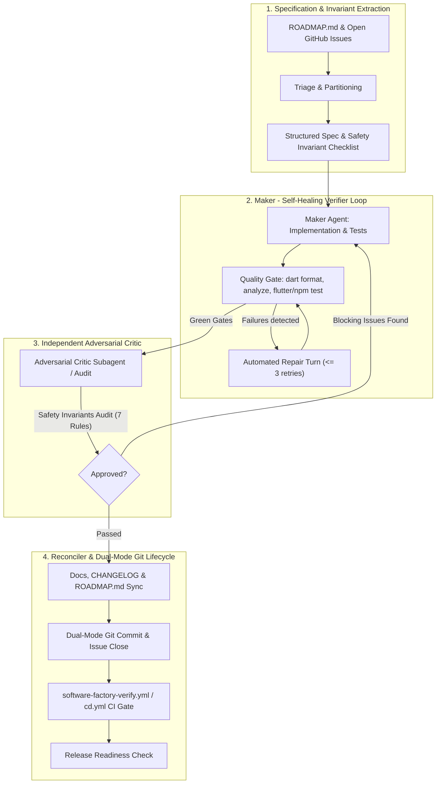
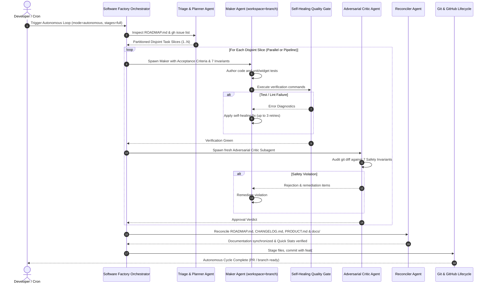

# Autonomous AI Software Factory Architecture, Patterns & Tooling

RealizeAlpha incorporates an **Autonomous AI Software Factory** architecture designed to automate, streamline, and safely scale software engineering, verification, release management, and documentation synchronization across the Flutter, Firebase, and Cloud Functions codebases.

---

## 1. Architectural Overview & Core Pattern

The RealizeAlpha Software Factory transitions engineering workflows from single-prompt, imperative coding into a closed-loop, deterministic **Maker–Verifier–Critic** state machine:



---

## 2. The Autonomous Loop Engine & Execution Topology

The Software Factory can operate in single-item mode or as a continuous **Autonomous Loop** that chains feature discovery, implementation, adversarial critique, and documentation without human intervention until release boundaries.



### Full-Cycle Pipeline Chaining
When invoked with `stages="full"`, the factory coordinates four sequential phases:
1. **Ideate / Triage Phase**: Scans `ROADMAP.md` and GitHub issues. In `mode=autonomous`, it scores candidate tasks against the **Software Factory Readiness Rubric** (clear code ownership, testable without production credentials, compliant with the 7 safety invariants) and automatically selects the top $N$ items.
2. **Implementation & Verification Phase**: Executes the Maker agent and Self-Healing Verifier loop.
3. **Adversarial Critique Phase**: Spawns an isolated critic subagent that audits the diff without shared author bias.
4. **Reconciliation & Release Readiness Phase**: Reconciles documentation, commits validated work, and audits release readiness.

### Disjoint Ownership Partitioning Rule
When running multiple tasks in parallel (`max_parallel > 1` via `workspace="branch"` or `workspace="share"`):
- Workers may only touch **mutually disjoint source files** in `src/robinhood_options_mobile/lib/` and `src/robinhood_options_mobile/functions/src/`. For example, Task A modifying `portfolio_analytics_controller.dart` cannot run concurrently with Task B modifying the same controller.
- Shared top-level files (`ROADMAP.md`, `CHANGELOG.md`, `PRODUCT.md`, `pubspec.yaml`) are **never edited by concurrent workers**. Instead, the coordinator reconciles shared files once in the final aggregation phase to eliminate git merge conflicts.

---

## 3. The 5-Stage State Machine

### Stage 1: Specification, Triage & Disjoint Partitioning
- **Source of Truth**: `ROADMAP.md` and open GitHub issues (`gh issue list --state open --limit 1000 --json number,title,body,labels,milestone,updatedAt`).
- **Triage**: Actionable unchecked items (`- [ ]`) are filtered by milestone, priority, and clear code ownership.
- **Safety Invariant Extraction**: Extracts the applicable RealizeAlpha core safety invariants from `AGENTS.md` before writing code.

### Stage 2: Maker (Code & Tests)
- Implements the minimal, complete change satisfying the criteria.
- Adheres to repository architectural patterns:
  - Mobile app: `src/robinhood_options_mobile/lib/`
  - Cloud Functions: `src/robinhood_options_mobile/functions/src/`
  - Firestore security rules: `src/robinhood_options_mobile/firebase/firestore.rules`
- Authors focused unit and widget tests covering standard flows, edge cases, and regression boundaries.

### Stage 3: Self-Healing Verification Gate
The agent automatically executes targeted verification with an automated repair loop (up to 3 bounded retries):
1. **Dart Code Formatting**:
   ```bash
   cd src/robinhood_options_mobile && dart format --output=none --set-exit-if-changed .
   ```
2. **Strict Dart Static Analysis**:
   ```bash
   cd src/robinhood_options_mobile && dart analyze
   ```
3. **Targeted Flutter Tests**:
   ```bash
   cd src/robinhood_options_mobile && flutter test test/<impacted_test_file>.dart
   ```
4. **Cloud Functions Lint, Build & Tests**:
   ```bash
   cd src/robinhood_options_mobile/functions && npm run lint && npm run build && npm test
   ```
If any check fails, the agent inspects the stack trace, diagnoses root causes, applies a targeted patch, and re-tests.

### Stage 4: Independent Adversarial Critic (7 Core Safety Invariants)
Before concluding any implementation task, the changes are audited against RealizeAlpha's 7 Core Safety Invariants (either via a dedicated critic subagent or an explicit adversarial audit table):

| # | Invariant | Verification Standard |
|---|---|---|
| **1** | **Zero Plaintext Credentials** | Brokerage OAuth tokens and API secrets must be stored exclusively via `SecureTokenStorage` (`flutter_secure_storage`). Never write secrets to `SharedPreferences` or Firestore. |
| **2** | **Feature Access Hierarchy** | Precedence follows Remote Config `disabled` kill switch $\to$ explicit per-user overrides $\to$ `adminOnly` / `beta` / `public` stage in `FeatureAccessService`. |
| **3** | **Trading Safeguards & Quote Isolation** | Live-quote BUY guard ($> 3\%$ deviation block), Paper TP/SL exits isolated through simulated ledger (`account == null`), and dynamic sizing boundaries respected. |
| **4** | **Balance Masking & Privacy** | Masked portfolio balances (`AccountStore`) respected across all charts, widgets, and tooltips; multi-broker tax lots stay on-device. |
| **5** | **Cloud Functions Security & $O(1)$ Space** | All callables authenticate `request.auth` and validate inputs; technical indicator and backtest loops maintain $O(1)$ auxiliary space without slicing arrays per bar. |
| **6** | **UI Polish & Accessibility** | Financial rows consolidate spoken screen-reader text via `Semantics(label: ...)`; layouts do not overflow down to `320px` viewports. |
| **7** | **Zero Compile Errors & Strict Types** | Verification with `dart analyze` and `npm run build` shows zero warnings treated as errors or type mismatches. |

### Stage 5: Reconciler & Dual-Mode Git Lifecycle
- Synchronizes documentation across `docs/`, `PRODUCT.md`, `CHANGELOG.md`, and `ROADMAP.md`.
- Maintains `ROADMAP.md` invariants: bounded `Key Highlights` ($\le 5$ items), bounded `Completed Features ✅` focused on recent minor releases, and verified `Quick Stats`.
- **Dual-Mode Execution**:
  - **Interactive Mode**: Presents all diffs, tests, and documentation updates to the developer. Does not commit, push, or close GitHub issues unless requested.
  - **Autonomous / Factory Mode (`mode=autonomous`)**: Creates conventional commits (`feat(<scope>): <summary> (#<issue-num>)`), adds test evidence to the GitHub issue, and closes the issue with `gh issue close <num>`. Production release pushes to `main` retain an explicit human confirmation gate.

---

## 4. Tooling & Skills Directory

RealizeAlpha organizes its software factory capabilities into modular skills located in `.github/skills/`:

### 1. `software-factory`
- **Location**: [`.github/skills/software-factory/SKILL.md`](../.github/skills/software-factory/SKILL.md)
- **Workflow Script**: [`.github/skills/software-factory/scripts/factory_pipeline.py`](../.github/skills/software-factory/scripts/factory_pipeline.py)
- **Role**: Top-level orchestrator. Can execute end-to-end multi-stage pipelines (`ideate -> implement -> docs -> release-check`) or parallel multi-item batches using Antigravity's `run_workflow` primitives (`phase`, `agent`, `parallel`, `pipeline`).

### 2. `roadmap-implementation`
- **Location**: [`.github/skills/roadmap-implementation/SKILL.md`](../.github/skills/roadmap-implementation/SKILL.md)
- **Role**: Single-item focused implementation engine. Executes the 5-stage Maker-Verifier-Critic loop, self-healing quality gates, invariant audits, and Dual-Mode git lifecycle.

### 3. `roadmap-ideation`
- **Location**: [`.github/skills/roadmap-ideation/SKILL.md`](../.github/skills/roadmap-ideation/SKILL.md)
- **Role**: Discovers, shapes, and ranks candidate roadmap proposals by cross-referencing `ROADMAP.md` and GitHub issues. Evaluates proposals against the **Software Factory Readiness Rubric** (bounded scope, testable without external live credentials, adheres to 7 safety invariants).

### 4. `update-docs`
- **Location**: [`.github/skills/update-docs/SKILL.md`](../.github/skills/update-docs/SKILL.md)
- **Role**: Automated documentation synchronization and roadmap invariant checking. Verifies `Quick Stats`, caps `Key Highlights` at $3-5$ items, and ensures `pubspec.yaml` semantic version consistency.

### 5. `roadmap-release`
- **Location**: [`.github/skills/roadmap-release/SKILL.md`](../.github/skills/roadmap-release/SKILL.md)
- **Role**: Prepares semantic releases (`pubspec.yaml`, `CHANGELOG.md`, `ROADMAP.md`), verifies all claimed `[x]` items have tests, runs quality gates, and handles release tagging while strictly preserving human confirmation before pushing release commits to `main`.

---

## 5. CI/CD Integration & Automated Gates

The Software Factory integrates directly into GitHub Actions workflows:

1. **`software-factory-verify.yml`**:
   - Fast PR and branch verification workflow with concurrency cancellation.
   - Runs static safety invariant checks (e.g. scanning for plaintext tokens written to `SharedPreferences`), validates workflow YAML files, verifies Python script syntax, and checks `ROADMAP.md` structural invariants.
   - Executes strict `dart format`, `flutter analyze --no-fatal-infos`, impacted tests, and Cloud Functions `npm run lint && npm run build && npm test`.

2. **`cd.yml`**:
   - Enforces strict static analysis (with `continue-on-error: true` removed from `flutter analyze`) and Cloud Functions TypeScript compilation on all pushes to `main` and release builds.
   - Automatically extracts categorized release notes from `CHANGELOG.md` for Google Play (`distribution/whatsnew/whatsnew-en-US`) and TestFlight (`WhatToTest.en-US.txt`).

---

## 6. Execution Examples

### Running an Autonomous Single-Item Cycle
```text
/software-factory focus="agentic trading" mode="autonomous"
```

### Running Parallel Multi-Item Execution
```python
call_tool("run_workflow",
  ScriptPath=".github/skills/software-factory/scripts/factory_pipeline.py",
  Description="Execute parallel software factory cycle for v0.62.x",
  Args={
    "mode": "autonomous",
    "max_parallel": 2,
    "focus": "v0.62.x"
  }
)
```

### Interactive Roadmap Implementation
```text
/roadmap-implementation focus="progressive disclosure UI" mode="interactive"
```
