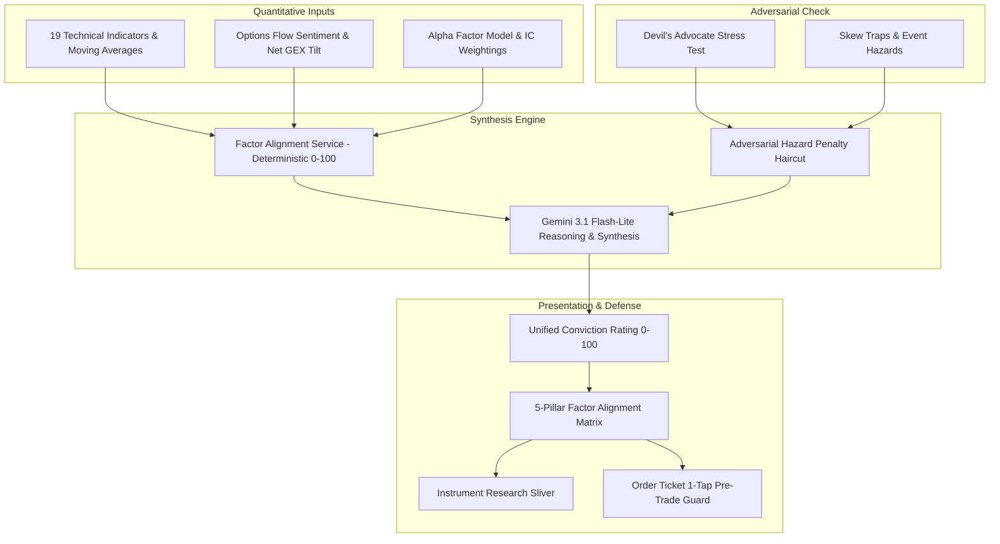

# Unified AI Conviction & Factor Alignment Engine

The **Unified AI Conviction & Factor Alignment Engine** synthesizes multi-factor quantitative models, options flow dynamics, and adversarial stress tests into a single, institutional-grade conviction score ($0 - 100$). It stream lines complex, disparate signals into clear trade conviction tiers with full transparency into underlying factor pillars.

---

## 1. Architectural Overview

---

## 2. Core Factor Pillars

The engine analyzes 5 core quantitative and behavioral pillars:

| Pillar | Key Indicators & Inputs | Weight | Description |
| :--- | :--- | :--- | :--- |
| **Trend & Moving Avgs** | SMA (10, 20, 50, 200), EMA, Price Action, ADX | $25\%$ | Multi-timeframe trend alignment and directional strength. |
| **Momentum & Oscillators** | RSI, MACD, Stochastic, CCI | $25\%$ | Velocity and acceleration across short- and intermediate-term cycles. |
| **Volatility & Squeeze** | Bollinger Bands, Keltner Channels, ATR | $15\%$ | Volatility contraction/expansion and breakout probability. |
| **Options Flow & GEX** | Institutional sweep urgency, Net Gamma ratio, Gamma Flip distance | $20\%$ | Market maker structural hedging pressure and smart money positioning. |
| **Adversarial Resilience** | Devil's Advocate score, Skew Traps, Event Hazards | $15\%$ | Downside skew and upcoming event vulnerability assessment. |

---

## 3. Adversarial Stress Penalty Haircut

Rather than relying purely on momentum or positive trend confirmation, the engine incorporates an explicit **Adversarial Stress Penalty**:

$$\text{Stress Penalty} = \min\left(30, (5 \times N_{\text{high\_hazards}}) + (4 \times N_{\text{high\_skew\_traps}}) + \max(0, (50 - \text{Resilience}) \times 0.4)\right)$$

$$\text{Final Conviction} = \max\left(5, \min\left(99, \text{Raw Composite} - \text{Stress Penalty}\right)\right)$$

### Conviction Tiers
- **Very High ($\ge 80$)**: Strong multi-pillar alignment with minimal adversarial downside risk. Standard position sizing.
- **High ($65 - 79$)**: Clear directional bias with manageable downside risks.
- **Moderate ($48 - 64$)**: Mixed indicator signals or moderate hazard penalties. Staggered entries recommended.
- **Low ($35 - 47$)**: Weak technical or quantitative foundation.
- **Conflicted ($< 35$)**: Severe indicator divergences or high-severity event hazards (e.g., imminent earnings with inverted volatility skew).

---

## 4. Backend Cloud Function (`generateUnifiedConviction`)

The Cloud Function (`functions/src/gemini.ts`) coordinates Gemini 3.1 Flash-Lite synthesis with 24-hour Firestore caching:
- **Authentication**: Mandatory `request.auth` verification (`unauthenticated` on missing auth).
- **Validation**: Strict validation of `symbol` (alphanumeric, 1-10 characters), `direction` (`Bullish` \| `Bearish`), and positive finite `currentPrice`.
- **Caching**: Stored in `ai_conviction/{symbol}_{direction}` to optimize latency and token consumption.
- **Model Fallback**: Primary `gemini-3.1-flash-lite`, automatically falling back to `gemini-2.5-flash-lite` on transient API errors.

---

## 5. UI Integration & Accessibility

1. **Research Tab (`InstrumentWidget`)**: Embedded in `_buildResearchSlivers` alongside Devil's Advocate and Price Targets.
2. **Order Tickets (`TradeInstrumentWidget` & `TradeOptionWidget`)**: 1-tap pre-trade conviction check before order execution to avoid entering trades into severe skew traps or conflicted regimes.
3. **Screen Reader Semantics**: Consolidated announcement detailing the symbol, direction, conviction score, tier, stress haircut, and actionable guidance.
